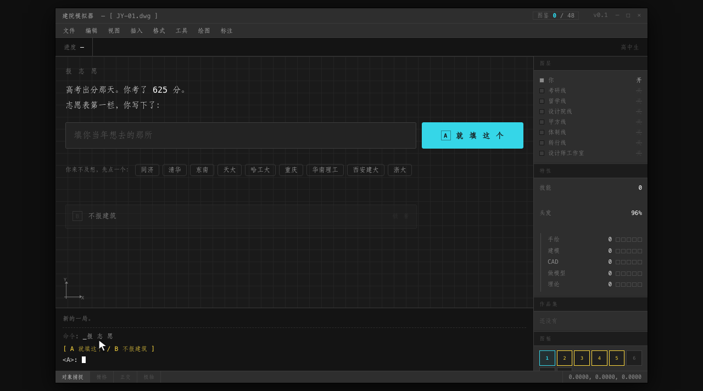
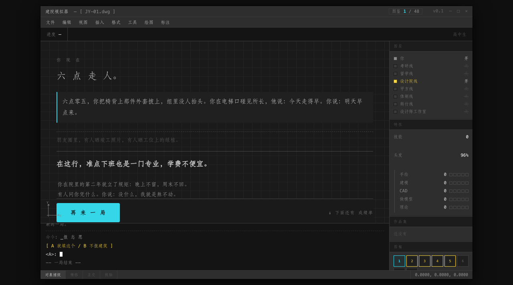
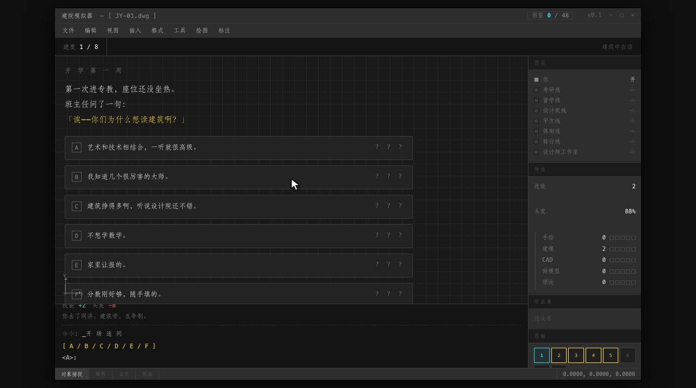
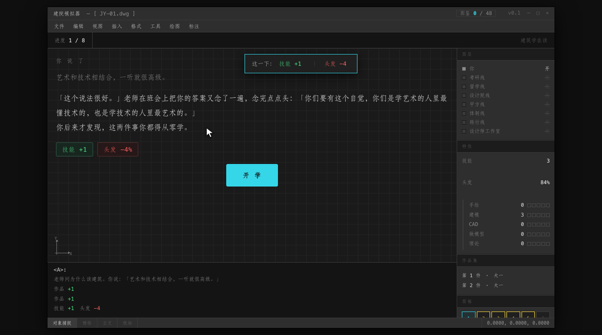

# 建院模拟器

这是一款建筑行业题材的文字模拟游戏。你从高考填志愿那一步开始，读完建筑学五年，
再走到毕业后的三年。一局 10 到 15 分钟，单人游玩，也可以几个人凑一台电脑轮流做决定。

[**▶ 在线玩**](https://archiloss.github.io/archi-life/) · [毕设题目抽签器](https://archiloss.github.io/archi-life/bishi.html)

---

## 关于这款游戏

开局先报志愿。考了多少分、那一年学校的线划到多少，开局就定了，你未必进得去自己想去的那个。
录取之后是开学第一周：班主任站在讲台上问「你们为什么想读建筑」，
你从六个回答里挑一个，挑完她会在班会上把它再念一遍。

全游戏八个回合，一年一个。每学期两个行动点，用在这几个去处上：

- 专教：画图、做模型
- 泡图书馆：抄案例、印条文
- 帮老师干活：收作业、搬卷尺、画底图
- 做竞赛：出方案、投稿
- 回宿舍：补觉

学期末过一关：大二评图、大三构造课、大四一草、大五毕设，过不过看这几年攒下的技能够不够。
一局 8 个回合、16 次行动。

走完五年，分岔成七条路：考研、留学、进设计院、进甲方、设计师工作室、进体制、转行。
每条路有自己的去处和卡组——考研线在刷题教室和宿舍之间来回，设计院线要接甲方的电话，
体制线坐靠窗的座，转行线得从头学新设计。

结局一共 48 个，只给称号，不分高低，跨局攒进图鉴，其中 5 个是提前收场的。
图鉴存在浏览器本地，换一局不清零。

## 特色

**界面是 AutoCAD。** 命令行、图层树、UCS 坐标轴、右下角的捕捉开关都在。
选项可以点，也可以直接在命令行里敲字母，敲错了字母会留在回显里。

**卡面上写的是实物。** 硫酸纸、丁字尺、卷尺、刻刀、安全帽、图钉、打印店、旧 U 盘。
设计院月发 2740、四十七份简历收到三个回复，这类数字也照实写在卡上。

**整个游戏是一个 HTML 文件。** 图形全是代码画的 SVG，没有一张图片素材，也不请求外部资源，
约 480KB，双击能开，手机和微信内置浏览器里都能跑。

## 截图

*结局卡。设计院线的一个落点，这一局头发还剩 96%。*

*开学第一周，班主任问为什么读建筑。六个回答的效果全是问号，选之前不知道要付什么。*

*选完当场结账：技能 +1，头发 -4%。*

## 技术

原生 HTML + CSS + JavaScript，没有框架，也没有构建依赖，不请求外部资源。
代码刻意用老语法写（以 `function` 声明为主），就是为了迁就旧版手机浏览器。
开发时源码拆在 `src/` 下，由 `build.py` 合成上面那个单文件；线上那份没有压缩混淆，
想看代码可以直接对着它读。

面向建筑行业从业者，以及已经转行的人。
